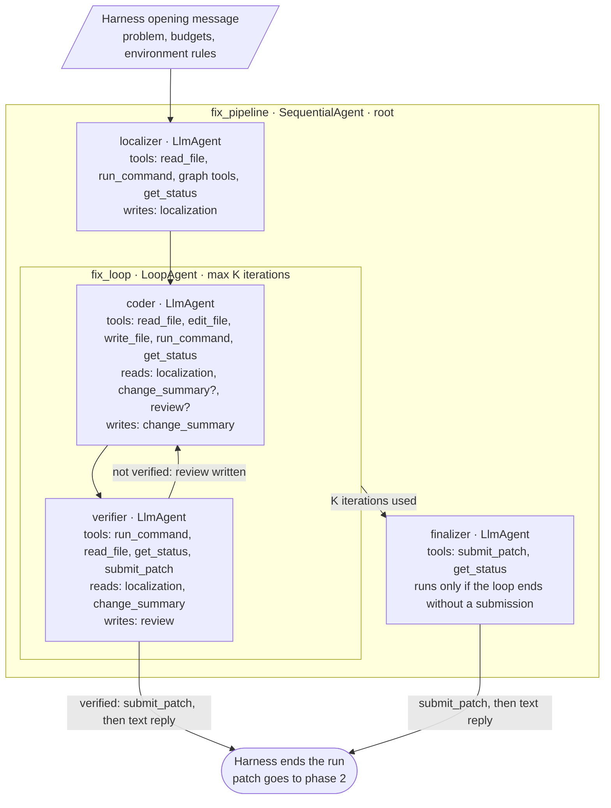
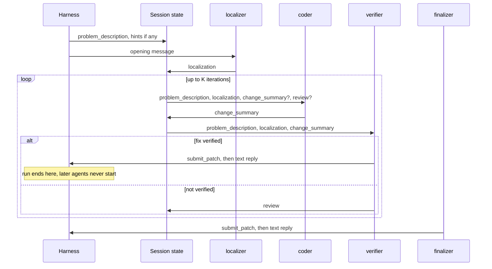

# Agent design: a workflow-agent pipeline for S1 and S2

Status: first implementation in `agent/`, Nov 10, 2026. Compiles with `adk_submission` 0.2.13. Submitted to Kaggle on Nov 10, 2026 (12B, loop cap 3, 5-minute task cap); scored 0.03 public, equal to the S0 anchor. The time model (PLAN.md, Nov 10) attributes this to thinking budgets that exceed the 5-minute cap; the lean config in section 11.2 is the response.

This document designs the agent tree that replaces the stock sample (S0) with ADK workflow agents. It implements the S1 and S2 scaffolds from `PLAN.md` so that each study factor is a single configuration value. Every harness fact it relies on was checked against `swegemma` 0.2.11, `adk_submission` 0.2.13 and the installed `google-adk` 1.36.1; section 2 lists them with sources.

## 1. Goals

1. **One factor, one value.** Verify-and-retry is the loop's iteration cap. Graph tools are one agent's tool list. The model is the `model:` line. Nothing else changes between arms.
2. **Bounded, observable compute per stage.** Localization, fixing and verification are separate agents, so the trace shows where time and tokens go.
3. **Small-model friendly context.** Later agents start from a compact state summary instead of the full shared history, which matters for E4B and 12B inside a 32,768-token window.
4. **Never lose a patch.** Every way the run can end leaves a scoreable diff, and no path triggers the harness's restart nudges.
5. **A measurable localization artifact.** The localizer writes its answer to session state, so file-level localization recall (hypothesis H3) can be scored directly against the gold patch.

## 2. Harness facts the design depends on

| # | Fact | Consequence for the design | Source |
|---|---|---|---|
| F1 | `LoopAgent` stops only on an escalation, a pause, or at `max_iterations`. The tool registry holds only the nine swegemma tools, with no `exit_loop`, and the agent runner passes no callback registry to the compiler. | No agent can break the loop by itself. | `google/adk/agents/loop_agent.py`; `swegemma/tools/__init__.py`; `swegemma/harness/agent_runner.py` (call to `compile_submission`) |
| F2 | Once `submit_patch` has been called, the harness ends the run at the next plain-text reply from any agent. | Submitting is the real exit. Only the agent that should end the run may hold `submit_patch`. | `agent_runner.py`, event loop after `is_final_response()` |
| F3 | If the root agent finishes without a submission, the harness sends up to three continuation nudges, and each one re-runs the root from the top. | A Sequential root would restart from the localizer. The design must always submit before the root finishes. | `agent_runner.py`, `max_nudges = 3` |
| F4 | One tool-call, turn and time budget covers all agents in a task. Inside one run of the root, exhausted tool-call or turn budgets make tools return errors but do not stop the agents. The time budget is checked on every event and stops the run. `submit_patch` and `get_status` are free and still work after the tool budget runs out. | Iteration caps must keep the loop inside the time budget. A final submit is always possible while time remains. | `agent_runner.py`; `swegemma/context.py`; `swegemma/tools/execution.py`; `HARNESS_README.md` §7.1 |
| F5 | If nobody submits, the harness scores the working-tree diff anyway. Diffs to test files and runner config (`conftest.py`, `pytest.ini`, `pyproject.toml` and others) are stripped from every patch. | Scratch reproduction scripts never count, but untracked non-test files in `/workspace` do end up in the patch. Scratch files belong in `/tmp`. | `HARNESS_README.md` §8.1 |
| F6 | `ParallelAgent` branches share the single task workspace. | Parallel agents must be read-only. | `HARNESS_README.md` §2.3; one sandbox per task in `agent_runner.py` |
| F7 | Initial session state always has `problem_description`. `hints` is set only when the task has hints, and all 129 dev tasks have empty hints. A required placeholder for a missing key raises `KeyError`; `{key?}` is optional. | Every prompt must write `{hints?}`, never `{hints}`. | `agent_runner.py` (`session_state`); `google/adk/utils/instructions_utils.py` |
| F8 | With `include_contents: none`, an agent sees only the latest user message or the latest reply from another agent, plus its own tool calls in the current turn. | Only the first agent sees the harness's opening message. Later agents need the problem and environment rules templated into their instructions. | `google/adk/flows/llm_flows/contents.py` (`_get_current_turn_contents`) |
| F9 | The harness's opening message contains the problem, budgets, environment rules (offline, `/workspace` only, no `pip install`) and the instruction to submit only after verifying, then reply in plain text. | The localizer gets this for free. Coder and verifier prompts must restate the environment rules. | `agent_runner.py` (`prompt_parts`) |
| F10 | A task resolves only if every test in the test files touched by the hidden test patch passes, with a valid JUnit report. | The verifier should run whole existing test files near the change, not single test functions. | `swegemma/harness/verification.py` |
| F11 | Generation defaults: `max_output_tokens` 16,384 and thinking budget 4,096, both capped at 32,768. Settings are per agent. | Each role can get its own thinking budget. | `swegemma/config.py` (`build_submission_limits`) |

## 3. Architecture

The root is a `SequentialAgent` with three stages: a localizer, a fix-and-verify loop, and a finalizer.

One task's control flow, showing how state moves between agents:

## 4. Agents

### 4.1 localizer

The localizer finds where the bug lives and how to reproduce it. It reads code, greps through `run_command`, and uses the three graph tools when they are enabled. It does not edit files. As the first agent it sees the harness's opening message, so it can run with either context mode; `none` is chosen for consistency, and per F8 it still receives the opening message as the current user input.

Its final reply is saved under `localization` in a fixed layout: a ranked list of files, the functions or classes in each, a one-line rationale per entry, and a suggested reproduction command or snippet. The fixed layout is what lets the analysis code score localization recall without reading the trace.

Starting thinking budget: 2,048 tokens. Soft budget stated in its prompt: about 15 tool calls.

### 4.2 coder

The coder implements the fix. It reads the problem, the localization and, from the second iteration on, the verifier's review and its own previous change summary. It edits with `edit_file` or `write_file` and may run quick checks with `run_command`. It does not hold `submit_patch`, so a coder that believes it is done cannot end the run before verification (F2).

With `include_contents: none` it starts each iteration fresh and does not see its own tool calls from earlier iterations. Continuity comes from `change_summary` and `review`. This trades some redundant re-reading for a context that stays small; section 9 lists it as a tuning question.

Its final reply, saved under `change_summary`, lists the files and functions changed, the intent of each change, and anything it could not finish. Starting thinking budget: 4,096 tokens.

### 4.3 verifier

The verifier decides whether the fix holds. It reproduces the original bug, confirms the fix, and runs the whole existing test files for the modules that changed (F10). It writes scratch scripts only under `/tmp` (F5) and must not modify source files. That rule lives in the prompt only, because `run_command` can write anywhere in the workspace.

If the fix holds, it calls `submit_patch` and replies with a one-line verdict, which ends the run (F2). If not, it replies with a review saved under `review`: the verdict, the failing command and its key output, and what the coder should change. Starting thinking budget: 2,048 tokens.

### 4.4 finalizer

The finalizer runs only when the loop uses all K iterations without a verified fix. It calls `submit_patch` and replies with a one-line note. This guarantees a submission before the root finishes, so the harness never sends restart nudges (F3), and it costs one or two model calls. Because `submit_patch` is free (F4), the finalizer works even after the tool budget is spent. A failing patch scores the same as no patch, so submitting unconditionally has no downside. Thinking is off.

### 4.5 Tool matrix

| Tool | localizer | coder | verifier | finalizer |
|---|---|---|---|---|
| `read_file` | yes | yes | yes | |
| `run_command` | yes | yes | yes | |
| `edit_file`, `write_file` | | yes | | |
| `search_similar_code`, `get_code_neighbors`, `get_code_subgraph` | graph-on arms only | | | |
| `get_status` | yes | yes | yes | yes |
| `submit_patch` | | | yes | yes |

Graph tools sit with the localizer only. That keeps the graph ablation to a single tool list and confines its effect to the stage that H3 measures.

## 5. State contract

| Key | Written by | Read by | Content |
|---|---|---|---|
| `problem_description` | harness | coder, verifier | The task's problem statement. |
| `hints` | harness, only when non-empty | all, as `{hints?}` | Task hints. Empty for every dev task. |
| `localization` | localizer | coder, verifier | Ranked files and symbols, rationale, reproduction suggestion. |
| `change_summary` | coder | coder on the next iteration, verifier | Files and functions changed, intent, unfinished items. |
| `review` | verifier | coder on the next iteration | Verdict, failing command and key output, requested change. |

`output_key` overwrites a key each time its agent finishes, so every iteration replaces the previous summary and review.

## 6. Exit paths

| Path | Trigger | What gets scored |
|---|---|---|
| Verified fix | Verifier submits and replies. | The submitted patch. |
| Loop exhausted | K iterations without a verified fix; finalizer submits. | The current working-tree patch. |
| Time budget | Session wall-clock limit reached on any event. | The working-tree diff, by the harness fallback. |
| Tool or turn budget | Tools start returning errors; agents continue to the finalizer, whose `submit_patch` is free. | The finalizer's submission. |
| Crash or unhandled error | The run aborts. | The working-tree diff, if any. |

No path ends the root without a submission, so the restart nudges of F3 should not occur. If the trace shows a nudge, that is a bug to investigate.

## 7. Mapping to the study

| Arm | Loop cap K | Localizer graph tools | Everything else |
|---|---|---|---|
| S0 | n/a: the stock sample | stock | stock |
| S1 | 1 | on | identical across arms |
| S2 | 3 to start; tuned on the tuning split | on | identical across arms |
| Graph ablation | same as the arm it ablates | off | identical across arms |

S1 still verifies once, matching PLAN.md's "localize, reproduce, patch, run targeted tests, submit". S1 and S2 differ only in whether a failed verification gets another coder turn. The model is shared by all four LLM agents, so a model switch edits four `model:` lines and nothing else.

What the design makes measurable, alongside resolution rate:

- **Localization recall and precision** from the `localization` reply, against the files in the gold patch.
- **Iterations used** and the verifier's verdict on each.
- **Exit path** per task, from which agent submitted.
- **Verifier calibration:** how often a verified submission fails phase 2, and how often a finalizer submission passes.
- **Time and tokens per stage**, from the trace's per-agent events.

## 8. Prompt plan

| Agent | Starting source | Changes |
|---|---|---|
| localizer | `data/sample_submission/prompts/analyzer.md`, plus the "Identify Target Files" section of the sample `system.md` | Add the output layout of section 4.1 and the soft budget. |
| coder | `agent/prompts/system.md` (the revised prompt) | Remove the submission instructions. Add `{problem_description}`, `{hints?}`, `{localization}`, `{change_summary?}`, `{review?}` and the environment rules of F9. |
| verifier | The "Run Targeted Tests Only" and "Immediate Patch Submission" sections of the sample `system.md` | Add whole-file testing (F10), the `/tmp` rule (F5), the no-edit rule, the submit-or-review decision and the review layout. |
| finalizer | New, a few lines | Submit, then reply in one line. |

Two rules apply to every prompt. No prompt may name the dev repositories, since the hidden tasks come from private ones. Every hints placeholder must be optional (F7).

## 9. Risks and open questions

- **Verifier false passes.** The verifier cannot see the hidden tests, so it may approve a fix that fails phase 2. Running whole test files reduces this but cannot remove it. The calibration metric in section 7 measures it.
- **Coder memory across iterations.** Fresh context may make the coder redo work or repeat a rejected approach. Compare against default context on the tuning split before freezing.
- **Stage budget split.** The localizer or a long coder turn can consume most of the time budget. The prompts' soft caps plus `get_status` are the only levers, since budgets are shared (F4).
- **Instruction following on small models.** The design relies on "submit, then reply in text" and on fixed reply layouts. E4B may drift. If the verifier submits and then keeps calling tools, the run simply continues until its next text reply, which is safe.
- **Shared rules duplicated across prompts.** It is unverified whether one instruction can combine two `!include` files. Until checked, each prompt carries its own copy of the environment rules.
- **Scorer parity.** The facts above come from the agent runner the notebook uses. The scorer's own inference script is not public. A Kaggle smoke test with the real budget is the final check.
- **Parallel localization, deferred.** Two read-only localizers, one graph-based and one grep-based, could run under a `ParallelAgent` and write separate keys (F6). That doubles localization cost and is out of scope until S1 and S2 work.

## 10. Alternatives considered

- **Single agent with a structured prompt.** Simplest, but the compute per stage is not controllable, and there is no localization artifact to score.
- **Localizer as an `AgentTool` called by the coder**, as in the sample. The coder decides whether and when to localize, so the graph ablation would also change the control flow, confounding H3.
- **Coder holds `submit_patch`.** A confident coder would end the run before verification (F2), which makes S1 and S2 indistinguishable in practice.
- **Default context for every agent.** Less prompt plumbing, but small models fill the window quickly, and the harness's compaction at about 14,000 tokens summarizes history in ways the design cannot control.

## 11. Files to create once approved

- `agent/agent.yaml`: the root `SequentialAgent`.
- `agent/sub_agents/`: `localizer.yaml`, `fix_loop.yaml`, `coder.yaml`, `verifier.yaml`, `finalizer.yaml`.
- `agent/prompts/`: one prompt per LLM agent.
- `agent/configs/`: one generation config per role.
- `agent/eval_config.yaml`: per-task budgets.

Validation order: compile with `compile_submission` from the local wheel, then a Kaggle smoke test on two or three tuning-split tasks with a real budget, then prompt tuning on the 42-task tuning split.

### 11.1 Implementation notes, first version

Choices made while writing the files that this document did not fix:

- **Model:** 12B in all four LLM agents, matching the notebook default and the S0 anchor.
- **Loop cap:** `max_iterations: 3` in `sub_agents/fix_loop.yaml`, so the shipped version is S2. S1 is the same file with 1.
- **Thinking history:** every generation config sets `include_thoughts: false`. Thinking stays on for each call, but old thoughts are dropped from history, which keeps long tool loops inside the 32,768-token window. Keeping thoughts is a tuning question.
- **Output caps:** `max_output_tokens` is 4,096 for the localizer and verifier, 8,192 for the coder and 1,024 for the finalizer. This leaves room for the prompt, given the unconfirmed report that an overflow can lose a patch.
- **Problem in every prompt:** the localizer's instruction also templates `{problem_description}`. If a nudge ever re-runs the root, the localizer would otherwise see only the nudge text.
- **Optional state everywhere:** `localization`, `change_summary` and `review` are read as optional placeholders, so a stage that ends without a text reply cannot crash the next one.
- **Budgets:** `eval_config.yaml` sets 5 minutes, 80 tool calls, 150 turns and a 120-second command timeout. About 120 tasks at 5 minutes fit the 12 hours with room for setup.
- **Graph prompt:** the localizer prompt describes the graph tools. The graph-off arm will need its own prompt file as well as the shorter tool list.

### 11.2 Lean config, second version (Nov 10)

The first submission scored 0.03 and ran 13 hours: 120 tasks at the full 5-minute cap plus about 1.3 minutes of setup each. A time model built from the harness code showed why. At any plausible decode speed on 4x L4 (25 to 50 tokens per second), the first version's thinking budgets alone exceeded the cap before the coder could edit. Compaction cannot help, because the runner compacts only after the whole pipeline returns.

Changes, all without LoRA:

- **Thinking budgets** 0 for the localizer, verifier and finalizer, 1,024 for the coder. Thinking is spent only where it pays, on planning the edit.
- **Output caps** 2,048 for the localizer and verifier, 4,096 for the coder. Thinking tokens count toward the cap.
- **Soft tool-call caps** in the prompts: 6, 8 and 4. The coder makes its first edit within 4 calls.
- **Output discipline:** grep is capped with head, pytest output with tail, and the verifier runs one test file instead of two.
- **Budget exhaustion:** every agent stops calling tools and replies at once when a tool reports an exhausted budget; the verifier submits first.
- **Unchanged:** loop cap 3, the structure.
- **Task cap:** raised from 5 to 6 minutes, the largest value that is safe if the 12-hour limit counts agent time only.
- **Model:** switched from 12B to 31B for the second submission, at Rishi's request. This run therefore changes model and config together, so its score cannot be attributed to either alone. The notebook's `MODEL_NAME` must also be 31B, or its section 2 cell rewrites the model lines.

Estimated time to the first verification with these settings: about 250 s at 50 tokens per second and about 430 s at 25. If the next run time is still near 13 hours, the next lever is structural: fold the localizer into the coder.

### 11.3 Probe findings and third version (Nov 11)

The second version (section 11.2) was run on the eight-task probe subset (`splits/probe_subset.json`) in a clone of the official notebook, on 31B with the 6-minute cap. These notes come from the live console of tasks 2 to 7. The final tables and traces are not in yet, so the counts below are provisional and no solve rate is claimed.

**What was observed**

- **Speed:** a tool call took about 3 seconds end to end. The time model in section 11.2 assumed 10 seconds or more. Six minutes therefore holds roughly 120 calls, and the 80-call cap now binds before the time cap does.
- **The designed exit works:** on at least one task the verifier ran its checks, called submit_patch and replied VERIFIED, which ended the task early.
- **Exact repetition (tasks 5 and 6):** an agent sent the same tool call with the same arguments dozens of times. In task 5 the localizer ran one reproduction command about 45 times, with identical output that did not show the bug. In task 6 the localizer read the same file until all 80 calls were used.
- **Budget starvation (task 6):** the tool budget is shared by all agents and nothing reserves a share for each. After the localizer used all 80 calls, the coder had time left but every call returned BudgetExceeded. It retried the same call about once a second and produced no patch.
- **Exploration without commitment (task 7):** 79 of 80 calls were used with no edit made. The console suggested the coder; the traces show the localizer made 71 of them and the coder only 8 (corrected in section 11.4).
- **Prompt limits were ignored:** no agent kept to the call counts in its prompt (6 for the localizer, 8 for the coder), and neither the harness's low-budget warning nor the BudgetExceeded error changed behavior.

**Likely cause, not yet confirmed from traces:** the localizer and verifier run with thinking off and temperature 0.2. With an unchanged context and no reasoning step, the most probable next action after a result that adds nothing is the same call again. Section 11.2 traded the first version's overthinking for this.

**Open question for the traces:** whether the localizer in task 6 passed start_line and end_line. Answered in section 11.4: it tried to, but the argument name arrived malformed.

**Changes in the third version**

- **Caps:** `max_tool_calls` 80 to 400 and `max_turns` 150 to 500, so that time is the only limit that binds. The harness accepts these values; `swegemma/config.py` applies no maximum. Side effect: the harness's low-budget warning never fires at this cap.
- **Call counts removed from the prompts.** They are replaced by a time rule: get_status is free and reports time_seconds_remaining; the localizer aims to finish within about a quarter of the task's time, and the coder must have an edit in place before half of it is gone.
- **No-repeat rule** in the localizer, coder and verifier prompts: never repeat a tool call with the same arguments.
- **Reproduction rule** for the localizer: if the reproduction does not show the bug, change it once, then report it as unconfirmed.
- **read_file guidance:** it returns the top of the file unless start_line and end_line are passed; find the line with grep -n first.
- **BudgetExceeded** is named explicitly as an error that no retry can fix.

**Not changed, pending the traces:** thinking budgets, temperatures, the loop cap of 3, and a repetition penalty in the generation settings (whether the competition compiler allows one is unchecked).

These prompt changes were chosen from console output on six tuning tasks, before the traces were read. They are untested. The next probe run on the same eight tasks is the check, and because those tasks have now informed the prompts, a result on them is a tuning result only.

### 11.4 Trace findings (Nov 11)

Read from the probe traces in `results/probe8-1/` (build 2: the Nov 10 submission). Two statements in section 11.3 were corrected by this reading.

**Why the localizer overran in four of eight tasks.** There are three distinct causes, and only one is plain repetition.

| Task | Localizer calls | Distinct calls | Cause |
|---|---|---|---|
| rich_3064 | 56 | 15 | Plain repetition: one reproduction command sent 42 times in a row with identical output that did not show the bug |
| fastapi_14873 | 80 | 29 | Malformed argument: 43 reads arrived with the key `start_line"` (a stray quote), so the tool ignored it and returned the top of the file with status ok. The model kept asking for lines 920 to 980 and kept getting lines 1 to 150 |
| fastapi_14962 | 71 | 52 | Open-ended exploration without stopping |
| fastapi_14262 | 60 | 54 | Open-ended exploration without stopping |

**Malformed tool calls are a second failure mode.** In fastapi_14262 the coder's first edit succeeded. Its next edit carried Python code with colons and brackets in new_string, and the arguments arrived split into garbage keys with old_string missing. The tool replied that a mandatory parameter was missing and that it could be retried. The coder resent the same malformed call 47 times. Across all eight traces, 91 of 484 file and command calls (19%) had unexpected argument keys, all in these two tasks plus one stray command. The likely source is the model's native tool-call syntax breaking on quotes or brackets inside argument values, at temperature 0.2 with thinking off; whether vLLM's gemma4 tool parser contributes is not established.

The dangerous case is the silent one: a malformed optional argument is dropped and the tool still reports status ok, so the model cannot tell that its request was not honoured.

**The verifier question.** The verifier approved all four patches it saw, and three failed the hidden tests. Comparing each patch with the reference fix:

| Task | Patch vs reference fix | Hidden test exit code | Reading |
|---|---|---|---|
| fastapi_14361 | Same guard on the same line (skip schemas without a `$ref` key) | 2 | Pytest exit code 2 usually means a collection error, not a failing assertion. The hidden test imports `inline_snapshot`. Probably the probe's test environment, not the agent |
| requests_6589 | Same behaviour for str input (count UTF-8 bytes) | 1 | The harness runs the whole hidden test file (`tests/test_requests.py`) and needs exit code 0 for all of it. An unrelated failure in that file, for example in an httpbin-backed test, would fail the task. Not established |
| rich_3718 | Different and incomplete: styles the title in one branch only, while the reference fixes the shared border style used by both title and subtitle; the hidden test checks the subtitle too | 1 | A real coder miss that the verifier could not see. Its own reproduction checked only the title, and the existing panel tests passed |

So the claim in PLAN.md that the verifier "approves everything" overstated it: two of the three approved patches are correct in substance. The hidden-test output that would settle the first two was not saved by the probe cell (fixed for the next run). The notebook verifies with the subprocess sandbox, while the scorer uses a Docker container, so a probe "not resolved" may not match the scorer's verdict.

**Corrections to section 11.3.** Task 7's 79 calls were mostly the localizer's (71), not the coder's. The localizer in task 6 did pass line ranges; the argument name was malformed in transit.

**Implications** (the malformed-call rule below was added to build 3 on Nov 11, before build 3 was probed)

- The no-repeat rule in build 3 addresses rich_3064 directly and fastapi_14262 partly. It does not tell the model what to do when a call comes back wrong.
- Added to the localizer, coder and verifier prompts: if a tool result does not match the request (wrong lines, a missing-parameter error), the call was garbled, so do not resend it; read a range with `sed -n 'A,Bp' file` through run_command, and keep edit strings short. The coder is also told that a missing old_string means its arguments were garbled, and to retry with one or two lines per edit.
- Probe resolved counts are a lower bound until the hidden-test output is checked task by task.

### 11.5 Build 3 probe (Nov 11)

Same eight tasks, same notebook, build 3 (`results/probe8-2/`). Build 3 raised the caps to 400 tool calls and 500 turns so that only time binds, and replaced the call counts in the prompts with a time rule (check get_status), a no-repeat rule and a malformed-call rule.

| Task | Resolved | task_s | Ended by | Agents reached | Longest identical run | Patch |
|---|---|---|---|---|---|---|
| fastapi_14361 | no | 282 | submit_patch | localizer, coder, verifier | 1 | source (same fix as probe 1) |
| requests_6589 | no | 362 | time cap | localizer | 135 (localizer, reproduction command) | empty |
| rich_3894 | yes | 120 | submit_patch | localizer, coder, verifier | 1 | source |
| rich_3718 | no | 363 | time cap | localizer | 39 (localizer, reproduction command) | empty |
| rich_3064 | no | 363 | time cap | localizer | 38 (localizer, reproduction command) | empty |
| fastapi_14873 | no | 370 | time cap | localizer | 30 (localizer, writes a reproduction script) | reproduction script only |
| fastapi_14962 | no | 369 | time cap | localizer | 81 (localizer, grep) | reproduction script only |
| fastapi_14262 | no | 368 | time cap | localizer, coder | 3 | source plus two reproduction scripts |

**Decision rule (PLAN.md, Rishi item 9).** Fails (a), (b) and (c); passes (d). Build 3 is not submitted.

**Findings**

- **Removing the cap turned bounded loops into time-cap loops.** In probe 1 the shared 80-call budget ended each loop, though it then starved the next agent. In probe 2 the localizer looped until the 6-minute cap in six of eight tasks, so the coder never ran in five of them. In requests_6589 the localizer made 221 calls of which 12 were distinct.
- **The prompt rules did not bind.** get_status was called once across all eight tasks, so the time rule never acted. The no-repeat rule was broken in five tasks. The rule to change a failed reproduction once and move on was broken in four. The rule not to create files in /workspace was broken in three, and those scripts end up in the patch.
- **What triggers the loops.** Four of the five runs repeat a reproduction command whose output did not match the localizer's expectation of the bug. The localizer emits no text and no thinking between calls (thinking budget 0, temperature 0.2), so after one repeat its context holds only identical call and result pairs.
- **Thinking alone is not the cure.** In probe 1 the coder, which thinks with a 1,024-token budget, also repeated calls 47 and 69 times, both after malformed calls. All agents ran at temperature 0.2 in both probes.
- **The probe cannot resolve three of the eight tasks.** The notebook's subprocess sandbox lacks `inline_snapshot`. The hidden tests of fastapi_14361 and fastapi_14962 import it, and fastapi_14262's tests import `tests/utils.py`, which imports it. Collection fails with exit code 2 whatever the patch. fastapi_14361's patch matches the reference fix and still cannot pass here. So probe resolved counts are out of five, not eight, and only the scorer's Docker image can judge these three.
- **Sampling penalties would not help.** The harness allows `presence_penalty` and `frequency_penalty`. In vLLM these act only on tokens generated in the current response, and each tool call is a fresh response of about 40 tokens, so the earlier identical calls in the prompt are not penalized. vLLM's `repetition_penalty`, which does cover prompt tokens, is not an allowed field and would also penalize the file paths a correct call must copy.

**Fourth version (Nov 11).** Two changes on top of build 3, aimed at the loops above.

- The localizer no longer reproduces the bug. Its prompt limits run_command to read-only commands (grep, ls, cat, head, sed), forbids running python, pytest or scripts and writing files, and drops the REPRODUCE section from its reply. The verifier writes its own reproduction under /tmp, as it already could. This removes the trigger behind four of the five loops in probe 2, and the reproduction scripts that ended up in patches.
- `max_tool_calls` goes from 400 to 150 as a backstop. Tasks that were not looping used at most 76 calls in either probe. A looping localizer, at about 1.3 s per call, now hits the cap after about 3 minutes instead of running to the 6-minute cap. The cap is shared, so a loop that reaches it still ends the task for every agent; the gain is time saved across the run, not a rescued task.
- The prompts no longer say that tool calls are not rationed.

### 11.6 Build 4 probe (Nov 11)

Same eight tasks, build 4 (`results/probe8-3/`).

| Task | Resolved | task_s | Ended by | Localizer calls | Longest identical run | Patch |
|---|---|---|---|---|---|---|
| fastapi_14361 | no | 370 | time cap (in the coder) | 9 | 3 | source |
| requests_6589 | no | 356 | submit_patch | 4 | 1 | source |
| rich_3894 | yes | 351 | submit_patch | 4 | 1 | source plus a stray `repro.py` from the coder |
| rich_3718 | yes | 239 | submit_patch | 140 | 58 (localizer, grep) | source |
| rich_3064 | no | 228 | submit_patch | 140 | 84 (localizer, grep) | source |
| fastapi_14873 | no | 371 | time cap (in the verifier) | 73 | 1 | an empty file only; the verifier reverted the fix |
| fastapi_14962 | no | 367 | time cap after the tool-call budget ran out | 147 | 39 (localizer, grep) | empty |
| fastapi_14262 | no | 300 | submit_patch | 148 | 1 | source |

**Decision rule (PLAN.md, Rishi item 10).** Fails (a); passes (b), (c), (d) and (e). Under the rule, build 4 is not submitted.

**Findings**

- **Taking reproduction away from the localizer worked as intended.** It ran no python and wrote no files, and 6 of 8 tasks reached the verifier, the best of the three probes.
- **The localizer still loops, now on grep.** Three tasks repeat one grep 39 to 84 times. Two more explore without repeating (73 and 148 calls).
- **The localizer obeys the harness warning and nothing else.** Two localizers stopped at exactly 140 calls, the point where the harness adds "Only 10 tool calls remaining" to tool results, and the others at 147 and 148. The prompt's no-repeat and time rules never acted in any probe. The cost is that the coder and verifier share the last 10 calls; that was enough for rich_3718.
- **Compaction erases the localizer's history.** The harness compacts events at 14,336 prompt tokens (HARNESS_README section 7.2, not under our control). Each time, the localizer's prompt falls from about 14,500 to about 2,000 tokens: 9 times in probe 1, 13 in probe 2 and 15 in probe 3, in every case after the localizer passed about 40 calls. After a reset it cannot see what it already searched, so a no-repeat rule cannot work. In rich_3894 the coder was compacted once, and afterwards wrote `repro.py` into /workspace, where before the reset it had used /tmp.
- **The coder runs long after its first edit.** First edits land at 79 to 233 s. In fastapi_14361 the coder then alternated one python check and one read seven times until the time cap: a two-step loop that the identical-run count in rule (a) does not see. In rich_3894 its final reply ran to the 4,096-token output cap (113 s), echoing program output. Legitimate coder outputs in all three probes peaked at 1,711 tokens, thinking included.
- **The verifier broke its git rule and erased a fix.** In fastapi_14873, at 366 s, it ran `git checkout HEAD fastapi/routing.py` to test the unfixed code, which its prompt forbids. The time cap hit before it restored the file, so the final patch holds only an empty `current_fix.patch`.
- **Unlogged time.** In fastapi_14962 the last trace event is at 260 s and the task ends at the 367 s time cap. The likeliest cause is a long generation still in flight when the cap hit; not confirmed.

**Fifth version (Nov 11).** Two config changes on top of build 4, no prompt changes.

- The localizer samples at temperature 1.0, top_p 0.95 and top_k 64 (was temperature 0.2, top_p 0.95). This is the standard configuration the [Gemma 4 model card](https://ai.google.dev/gemma/docs/core/model_card_4) gives "across all use cases". Reason: in all three probes, every long run of one repeated valid call came from an agent with thinking off at temperature 0.2. The coder thinks, and its long identical runs only followed malformed calls. The risk is more malformed tool calls: the localizer's share was 1.4% of file and command calls in probes 2 and 3. ADK 1.36.1 passes top_k to LiteLLM, and LiteLLM 1.108.1 sends it in the request body with drop_params on (checked locally against a stub server; Kaggle's LiteLLM version is unknown).
- The coder's `max_output_tokens` goes from 4096 to 2560, to bound a runaway reply like the one in rich_3894.

Two other points from the model card, not acted on yet: Gemma 4 has a native system role; and thoughts from earlier turns should be dropped from history except in tool-call turns, where they should be kept. The coder runs with `include_thoughts: false`, which strips them from tool-call turns too.

### 11.7 Probe environment and sixth version (Nov 11)

**The probe's test environment is not the scorer's.** `install_test_dependencies` in `swegemma/harness/container_setup.py` returns at once for the subprocess backend, which the notebook uses. The scorer's Docker backend unpacks the competition wheels into the container and runs `sandbox/setup.py`. The saved hidden-test output from probe 3 shows the effect:

| Task | What fails in the notebook | Can it pass there? |
|---|---|---|
| fastapi_14361, fastapi_14962 | Hidden tests import `inline_snapshot`: collection error | No |
| fastapi_14262 | `tests/utils.py` imports `inline_snapshot`: collection error | No |
| requests_6589 | 187 setup errors, "recursive dependency involving fixture 'httpbin'": the `pytest-httpbin` plugin is missing | No |
| rich_3064 | Two hidden tests compare syntax-highlight colours that depend on the Pygments version (the target test also fails, which is the agent's miss) | No |
| rich_3894, rich_3718, fastapi_14873 | Nothing | Yes |

So in probes 1 to 3 only three of the eight tasks could be resolved, and build 4 resolved two of them. The agents are affected too: in fastapi_14361 the coder ran the existing test file twice and got the same import error both times, which it would not get on the scorer.

**Fix in the probe notebook.** The run cell now installs `inline-snapshot` and `pytest-httpbin` from the competition's offline wheels into a side folder and appends it to `sys.path`. Each sandbox venv is created with system site packages and copies every `sys.path` entry containing `site-packages` into a `.pth` file (`swegemma/sandbox/subprocess.py`), so tasks see the packages while the notebook's own packages are untouched. rich_3064 stays unmeasurable, because fixing it would mean replacing the notebook's Pygments. The cell is untested on Kaggle; it prints what it installed and cannot stop the run. The scorer's containers run Python 3.13 and the notebook runs 3.12, so a wheel with compiled code may not install; the cell then retries without dependencies.

**Sixth version.** Build 5's configs with rewritten prompts. The rewrite follows what the three probes showed the model obeys: the reply template and text inside tool results, not rule bullets.

- **Localizer.** The search tips became four numbered steps that end in "write the final reply". The reply gained a CONFIDENCE line, and the prompt says a best guess is a complete answer, so that stopping early is a legitimate result. The no-repeat and get_status rules, which never acted in three probes, are replaced by one stop condition (two searches in a row with nothing new) and by naming the harness's `budget_warning` as a signal to reply at once. 507 words became 391.
- **Coder.** The workflow became five steps that end in the reply: read, edit, at most one check, reply. After the check it may continue only if the check showed the edit is wrong. The reply is capped at eight lines with no pasted output. The git ban now comes with the allowed alternatives (edit_file to undo, git diff to look). 745 words became 665.
- **Verifier.** It is told that it never needs to run the unfixed code, and how to see the old code safely (`git show HEAD:path`). The git rule now lists the three allowed commands and says why the others are banned: they erase the coder's fix.

### 11.8 Build 5 probe (Nov 11)

Same eight tasks, build 5 (`results/probe8-4/`). The run started before the test-dependency fix of section 11.7 existed, so its environment matches probes 1 to 3, and the comparison with build 4 isolates the two config changes.

| Task | Resolved | task_s | Ended by | Localizer calls | Coder calls | Longest identical run | Patch |
|---|---|---|---|---|---|---|---|
| fastapi_14361 | no | 251 | submit_patch | 24 | 6 | 1 | source |
| requests_6589 | no | 280 | submit_patch | 4 | 8 | 1 | source |
| rich_3894 | yes | 363 | time cap (in the coder) | 36 | 14 | 2 | source plus two reproduction scripts |
| rich_3718 | yes | 132 | submit_patch | 25 | 10 | 1 | source plus `repro.py` |
| rich_3064 | no | 365 | time cap (verifier, after submit_patch) | 18 | 7 | 2 | source |
| fastapi_14873 | no | 362 | time cap (in the coder) | 18 | 51 | 1 | empty |
| fastapi_14962 | no | 362 | time cap (in the coder) | 91 | 11 | 1 | empty |
| fastapi_14262 | no | 365 | time cap (in the coder) | 34 | 30 | 3 | source, four files |

**Decision rule (PLAN.md, Rishi item 11).** Passes (a), (b), (c) and (e); fails (d). Under the rule, build 5 is not submitted.

**Findings**

- **The sampling change removed the identical-call loops.** The longest identical run fell from 84 to 3, and the localizer's calls across the eight tasks fell from 665 to 250. No task reached the 150-call cap. This is one run per build, so the size of the effect is uncertain, but the direction matches the prediction made before the run.
- **The cost of temperature 1.0 so far.** In rich_3894 the localizer ignored the read-only rule: it wrote `reproduce_bug.py` eleven times and ran python twice, 153 s in all. The share of malformed localizer calls rose from 1.4% to 2.4%, below the 5% line set in advance.
- **The coder is now the time sink.** It hit the time cap in four tasks. Each coder call writes about 830 tokens, most of it thinking, so a call takes about 23 s. In fastapi_14873 it made 51 calls (33 reads) and no edit at all.
- **write_file cannot write to /tmp.** The tool refuses with "Path traversal detected ... escapes workspace root". All 8 attempts across the four probes were refused, while the coder prompt said to put scratch scripts in /tmp. After a refusal the coder tends to write the script into /workspace, which is how `repro.py` files reach the patch.
- **The verifier kept working after submit_patch.** In rich_3064 it submitted at 270 s and then ran tests for another 90 s until the time cap, instead of replying. It was chasing two failures that come from the notebook's Pygments version (section 11.7).
- **Malformed edit_file calls returned in the coder** (9 of 134 calls, all in fastapi_14262 and with the same garbled keys as in probe 1). The coder's sampling was not changed.

- **rich_3064 is probably a hidden success.** Build 5's patch passes the task's target test (`test_partial_table`), which build 4's patch failed. The only two failures left are the Pygments-dependent tests that fail in the notebook whatever the patch (section 11.7). So build 5 fixed three of the four tasks the notebook can judge at least in part, against two for build 4.

**Carried into build 6 before its probe:** the coder prompt says that write_file cannot write to /tmp and shows the heredoc alternative; the verifier prompt says that submit_patch is its last tool call.

### 11.9 Build 6 probe (Nov 11)

Same eight tasks, build 6 (`results/probe8-6/`).

| Task | Resolved | task_s | Ended by | Localizer calls | Coder: first edit at | Coder: time after first edit | Longest identical run |
|---|---|---|---|---|---|---|---|
| fastapi_14361 | no | 122 | submit_patch | 13 | 78 s | 9 s | 3 |
| requests_6589 | no | 290 | submit_patch | 4 | 178 s | 31 s | 1 |
| rich_3894 | yes | 273 | submit_patch | 4 | 75 s | 180 s | 1 |
| rich_3718 | yes | 185 | submit_patch | 15 | 80 s | 65 s | 1 |
| rich_3064 | no | 367 | time cap | 26 | 246 s | 105 s | 14 (localizer, python) |
| fastapi_14873 | yes | 371 | time cap (in the coder) | 18 | 149 s | 216 s | 1 |
| fastapi_14962 | no | 368 | time cap (in the coder) | 98 | none | n/a | 2 |
| fastapi_14262 | no | 371 | time cap (in the coder) | 21 | 107 s | 258 s | 31 (coder, edit_file) |

**Decision rule (PLAN.md, Rishi item 12).** Passes (b), (c) and (e); fails (a) and (d). Under the rule, build 6 is not submitted.

**Across the builds** (one run each, so a difference of one task is within noise)

| Measure | Build 2 | Build 4 | Build 5 | Build 6 |
|---|---|---|---|---|
| Resolved, of the 3 tasks the notebook can judge | 1 | 2 | 2 | 3 |
| Reached the verifier | 4 | 6 | 4 | 5 |
| Patches that change a source file | 6 | 6 | 6 | 7 |
| Tasks with an identical run above 10 | 3 | 3 | 0 | 2 |
| Mean task time | 270 s | 323 s | 310 s | 293 s |

**Findings**

- **The coder procedure helped the simple tasks.** In fastapi_14361 the coder stopped 9 s after its edit (86 s in build 5), and the task finished in 122 s.
- **fastapi_14873 was resolved for the first time**, by a patch the coder left when the time cap hit.
- **The malformed edit_file loop is the same call every time.** In fastapi_14262 the coder's second edit fails in probes 1, 4 and 6. The trace shows how: the coder ends new_string with a backtick and a comma instead of the string delimiter, so old_string is never quoted and the parser splits its text at the colons. The coder then resends the same broken call (31 times here, about 250 s). The prompt's instruction to retry with shorter strings was not followed. The coder samples at temperature 0.2, the setting under which the localizer also resent identical calls.
- **The localizer ran python in one task again** (rich_3064, 19 calls), as in build 5 (rich_3894). At temperature 0.2 (build 4) it never did. The read-only rule holds less well at temperature 1.0.
- **Time before the first edit is now the larger share of the coder's time** in several tasks (178 s in requests_6589, with about 650 tokens of thinking per call).
- **The test-dependency fix had no effect.** The hidden tests still fail on `inline_snapshot` and the `httpbin` fixture. Whether the notebook cell ran, and what it printed, is not known yet.
- A check script flagged localizer python calls in fastapi_14962; those were greps for the name `dump_python`, not python runs.

**Seventh version (Nov 11).** Build 6 with one config change: the coder samples at temperature 1.0, top_p 0.95 and top_k 64, the model card's standard setting, as the localizer has since build 5. It targets the coder's identical resends of a malformed edit_file call. The risk is less exact edit text; the verifier and finalizer are unchanged.

### 11.10 Build 7 probe and eighth version (Nov 11)

Same eight tasks, build 7 (`results/probe8-7/`, notebook v4, fingerprint `a2ce0f1a`).

| Task | Resolved | task_s | Ended by | Localizer calls | Coder: first edit at | Longest identical run | Note |
|---|---|---|---|---|---|---|---|
| fastapi_14361 | no | 231 | submit_patch | 10 | 63 s | 1 | Verifier reverted the fix twice, then rebuilt it |
| requests_6589 | no | 150 | submit_patch | 4 | 47 s | 1 | |
| rich_3894 | yes | 220 | submit_patch | 8 | 91 s | 1 | |
| rich_3718 | yes | 129 | submit_patch | 22 | 79 s | 1 | |
| rich_3064 | no | 162 | submit_patch | 13 | 52 s | 1 | Wrong fix by the coder; verifier ran `git checkout .` three times |
| fastapi_14873 | no | 286 | tool-call budget, then finalizer | 19 | none | 125 (verifier) | Chain failure, below |
| fastapi_14962 | no | 369 | time cap (in the coder) | 47 | 217 s | 1 | |
| fastapi_14262 | no | 370 | time cap (in the coder) | 16 | 97 s | 2 | Patch now changes three files |

**Decision rule (PLAN.md, Rishi item 13).** Fails (a) only; passes (b) with 6 of 8, (c) with 7 of 8, (d) and (e).

**Findings**

- **Temperature 1.0 fixed the coder's resend loop.** Failed edit_file calls fell from 42 of 54 to 2 of 17, and malformed coder calls from 30% to 2.1%. In fastapi_14262 the coder got past the edit it had resent 31 times and changed three files. Mean task time fell from 293 s to 240 s, and only two tasks hit the time cap.
- **The localizer ran no python in this run** (it did in one task in each of builds 5 and 6, with the same config and prompt). Run-to-run variation is large, so single-task differences between builds should not be read as effects.
- **Chain failure in fastapi_14873.** The localizer's last output was a broken tool call (`call:grep ...`, with grep in the place of a tool name), which the harness took as its final reply. The coder, shown that text as its localization, ended the same way after five calls with no edit. The verifier then reran `git status --short && git diff`, which printed nothing, 125 times, and used up the shared tool-call budget. Such endings are the cost of temperature 1.0: none in four probes at 0.2, one in 16 localizer runs at 1.0 before this run.
- **The verifier reverts the coder's fix to test the unfixed code.** In fastapi_14361 it deleted lines with sed, ran `git checkout` on the file, and submitted an empty patch (patch_size 0). It then noticed, rebuilt the fix with a script and submitted again; the result happens to match the coder's edit. In rich_3064 it ran `git checkout .` three times and re-applied the change from a patch it wrote by hand. Both started when an existing test failed for reasons of the notebook's environment (section 11.7) and the verifier tried to find out whether the failure was there before the change. The prompt forbids this and says why; the rule held in build 6's probe (same verifier prompt and config) and broke here. This is the most damaging open failure, because it can erase or alter a correct fix without any sign in the summary tables. It is present in builds 6, 7 and 8 alike.
- **rich_3064 is a real coder miss here.** The coder added `justify=column.justify`, which does not address the missing table body. Build 5's coder wrote a correct fix for the same task.
- **The test-dependency fix cannot work as built.** `probe8/test_deps.txt` shows the competition wheels folder has 124 wheels and neither `inline-snapshot` nor `pytest-httpbin`. The harness lists `pytest_httpbin` among packages it does not inject from wheels, so the scorer's image must already carry it, and `sandbox/setup.py` or its stubs module probably supplies the rest. Options for a later session: read `sandbox/setup.py` from the competition data; upload the two packages and their dependencies as a private dataset; or run the probe with internet on, if a clone allows it.

**Eighth version.** Build 7 plus three prompt changes aimed at the chain failure (fingerprint `94a538c3`): the verifier's first command prints `NO CHANGES IN WORKSPACE` when nothing was edited, and the prompt sends it straight to NOT VERIFIED; every shell example names run_command, and all three prompts say that grep, sed, git and python are shell commands, not tools; the coder ignores a localization that is empty or not in the LOCATIONS layout. It does not address the verifier reverting fixes.

### 11.11 Build 8 probe and the submission choice (Nov 11)

Same eight tasks, build 8 (`results/probe8-8/`, notebook v4, fingerprint `94a538c3`).

**Decision rule (PLAN.md, Rishi item 14).** Fails (a) and (d); passes (b) with 8 of 8 tasks reaching the verifier, the best of all probes, (c) with 7 of 8 and (e). Resolved 2 of 8.

**Findings**

- **The chain fix held.** All eight tasks reached the verifier, and no agent ended on a broken tool call.
- **The verifier destroyed a correct fix.** In rich_3894 one existing test failed with the coder's change and passed without it. The verifier ran `git checkout` on the file to compare, which erased the change. It then read its own `NO CHANGES IN WORKSPACE` marker, tried to restore the fix from a blob hash with `git checkout <hash> --`, failed, and ran `git checkout -q . && git status ...` 55 times before replying NOT VERIFIED at 346 s. The task ended with an empty patch. Every build since build 4 had resolved this task. The marker added in build 8 did not stop this loop, because the loop was the verifier's own reverting. This is the same failure as in build 7 (section 11.10), now with a lost task.
- **The localizer resent a garbled call 33 times** in rich_3064: read_file with the start line folded into the file path (`rich/markdown.py`,start_line:234`). The tool returned an error each time. It also ran python 22 times in the same task.

**Comparison of the probed candidates** (one run each on eight tasks; differences of one task are within noise)

| Measure | Build 6 | Build 7 | Build 8 |
|---|---|---|---|
| Tasks with an identical run above 10 | 2 | 1 | 2 |
| Reached the verifier | 5 | 6 | 8 |
| Patches that change a source file | 7 | 7 | 7 |
| Mean task time | 293 s | 240 s | 314 s |
| Resolved (not deciding) | 3 | 2 | 2 |

The fallback rule written before the build 8 probe ranks first by the fewest tasks with an identical run above 10, which selects build 7. No build passed all five rules, so submitting build 7 is a recorded deviation from the rule.

**Next round, in order:** stop the verifier from reverting fixes (the most damaging open failure; it needs a mechanism the model obeys, such as a tool-result signal, since the prompt rule broke in builds 7 and 8); then the 8-minute cap as a single-change comparison; then the probe's missing test dependencies.

**Ninth version (Nov 11).** Build 8 with only `prompts/verifier.md` changed (fingerprint `2032e653`). It targets the verifier erasing the coder's fix, using the two levers the probes showed the model obeys: text inside tool results, and a concrete allowed way to reach the goal behind a ban.

- **Backup in the first command.** The verifier's first command still prints the status and diff, and now also saves the diff to `/tmp/coder_fix.patch`. Its last output line is one of three: a copy was saved; no edits exist but a saved copy does, with the exact `git apply` command to restore it; or no edits exist at all. The prompt maps each line to the next action.
- **A sanctioned comparison.** When the verifier wants to know whether a failing test also fails without the fix, it has one command that removes the fix with `git apply -R`, runs the test and re-applies the fix, ending with `git diff --stat` so that the result shows the fix is back. Python bytecode writing is switched off for that run: in a local test, a stale `.pyc` otherwise made the restored code behave like the unfixed code.
- **Empty submit.** If submit_patch reports patch_size 0, the prompt says to restore from the saved copy and submit again.
- Known gaps: a fix made only of new files is not in `git diff`, so it is not saved; and a time cap that hits in the middle of the comparison command would still leave the fix removed.

**Tenth version (Nov 11).** Build 9 was never probed. An outside review of the prompts found defects in its new verifier commands, and each was checked against the harness source or a trace before anything changed (fingerprint `1c756b85`).

| Review finding | Check | Outcome |
|---|---|---|
| The compare command can erase the fix on a timeout | `run_command` limits a command to the smaller of 120 s and the task's remaining time, and a timeout kills the whole process group | Fixed: the test now runs on a separate copy of the original code (`git worktree add --detach /tmp/base HEAD`), and /workspace is never modified |
| Checks can import an installed package instead of the edited code | requests task, probe 8: before any edit the check printed 6, and 2 with `PYTHONPATH=src`. The sandbox venv has no pip, so the editable install fails silently | Fixed in the examples: python commands in the coder and verifier prompts start with `PYTHONPATH=/workspace:/workspace/src`. Probably a probe-only problem, since the scorer's container can install the checkout |
| A fix made only of new files is reported as no edits | True of plain `git diff` | Fixed: detection uses `git status`; the saved copy holds modifications to existing files, which is what `git checkout` erases |
| The status message can be cut off | `run_command` returns `stdout[:5000]` | Fixed: the status line prints before the diff, and the diff is capped at 3,500 characters |
| `pytest \| tail` hides the exit code | True | Not changed: it would turn a failing test from status ok into CommandError, a change in what the model sees that needs its own probe |
| Stopping rules are indirect | True, and the probes show such rules do not bind | Not changed: needs its own probe |

A second known gap remains: after `submit_patch` (which runs `git add -N .`), a `git checkout .` empties new files, and the saved copy does not hold them.

### 11.12 Build 10 probe (Nov 11)

Same eight tasks, build 10 (`results/probe8-10/`, notebook v4, fingerprint `1c756b85`).

| Task | Resolved | task_s | Ended by | Verifier: first-command result | Compare on the separate copy | Commands that change /workspace |
|---|---|---|---|---|---|---|
| fastapi_14361 | no | 137 | submit_patch | saved a copy | 1 | 0 |
| requests_6589 | no | 293 | submit_patch | saved a copy | 0 | 0 |
| rich_3894 | yes | 208 | submit_patch | no edits, then saved a copy | 0 | 0 |
| rich_3718 | yes | 356 | submit_patch | saved a copy (twice) | 36 | 0 |
| rich_3064 | no | 297 | submit_patch | saved a copy | 4 | 0 |
| fastapi_14873 | yes | 365 | time cap (in the coder) | verifier not reached | | |
| fastapi_14962 | no | 365 | time cap (in the coder) | verifier not reached | | |
| fastapi_14262 | no | 365 | time cap (in the coder) | verifier not reached | | |

**Decision rule (PLAN.md, Rishi item 15).** Fails (a) only; passes (b) with 5 of 8, (c) with 8 of 8 (the first build where every task ends with a source patch), (d) and (e).

**Findings**

- **The verifier no longer reverts fixes.** Across five verifier runs it ran no `git checkout`, `git stash`, `git reset` or `sed -i`. In builds 7 and 8, with the earlier verifier prompt, 3 of 14 verifier runs did, and one resolved task was lost. When it wanted the old behaviour it used the separate copy, 41 times in all.
- **It copied the long first command exactly,** 7 of 7 times at 371 characters.
- **The no-edit bounce worked.** In rich_3894 the first round left no edit; the command printed NO EDITS IN WORKSPACE, the verifier replied NOT VERIFIED at once, the coder's second round made the edit, and the task was resolved in 208 s.
- **One loop remains.** In rich_3718 the verifier adapted the compare command to run a check script of its own, which had a Python syntax error, and resent it 34 times (about 190 s) before moving on and submitting. The workspace was untouched and the task was still resolved. The verifier samples at temperature 0.2, the setting under which the other agents used to resend identical calls.
- **The coder is where the three unfinished tasks stop.** In all three fastapi tasks that hit the time cap, the coder was still working at the cap, 116 to 250 s after its first edit.

**Candidates** (one run each on eight tasks; a difference of one task is within noise)

| Measure | Build 6 | Build 7 | Build 8 | Build 10 |
|---|---|---|---|---|
| Tasks with an identical run above 10 | 2 | 1 | 2 | 1 |
| Reached the verifier | 5 | 6 | 8 | 5 |
| Patches that change a source file | 7 | 7 | 7 | 8 |
| Mean task time | 293 s | 240 s | 314 s | 298 s |
| Verifier runs that changed /workspace | 0 of 5 | 2 of 6 | 1 of 8 | 0 of 5 |
| Resolved (not deciding) | 3 | 2 | 2 | 3 |

### 11.13 Skill scripts for the verifier (eleventh version, Nov 11)

Build 11 (fingerprint `54f950e7`, not yet probed) moves the verifier's save, compare and restore commands out of its prompt and into a skill, `agent/skills/verify-fix`. In build 10 the verifier retyped a 371-character shell command and a long compare command; in its probe it copied the first exactly, but adapted the second into a broken script and resent that 34 times. With a skill the model passes a script name and at most one argument, and the logic cannot be mistyped.

**How skills run, from the source (google-adk 1.36.1, swegemma 0.2.11).** An agent lists skill directories under `skills:` (a competition key). The compiler loads each with ADK's `load_skill_from_dir` and adds a `SkillToolset`, which gives the agent four tools: `list_skills`, `load_skill`, `load_skill_resource` and `run_skill_script`. For `run_skill_script`, ADK builds a self-extracting Python program holding the skill's files, which copies them into a temporary folder, changes into it and runs the script. The harness's `AdkSandboxCodeExecutor` writes that program to `/workspace/.adk_exec_<id>.py` and runs it with `python3` inside the task sandbox, with the same time limit as a command (the smaller of 120 s and the time left). So the scripts can read and change the repository, but their own working directory is not the repository. `SKILL_TOOLSET` is an experimental ADK feature that is on by default in 1.36.1, and the harness README documents the skill tools, so the scorer expects them. The toolset also appends ADK's default skill instruction to the verifier's system prompt, which tells the model to call `load_skill` before using a skill; that may cost one extra call per verifier run.

**The scripts** (standard library only; each prints one result line in capitals before any long output, and caps its output at about 3,500 characters):

| Script | Arguments | What it does |
|---|---|---|
| `check_fix.py` | none | Lists changed files, saves edits to existing files as a patch inside `.git/agent_state/` (invisible to git status and to the submitted diff), and prints SAVED A COPY OF THE FIX, THE FIX IS MISSING, ONLY NEW FILES or NO EDITS IN WORKSPACE, then the start of the diff |
| `compare_test.py` | `test`: one test file | Runs it with the fix; if it fails, runs it on a separate copy of the original code (`git worktree`, made once per task under the sandbox's tmp folder) and prints a VERDICT: passes with the fix, broken by the fix, or fails with and without it. Each run is capped at 50 s and sets `PYTHONPATH` to the copy under test, for flat and `src/` layouts. The repository is never modified |
| `restore_fix.py` | none | Puts the saved patch back, resetting only the files named in it first if the patch does not apply cleanly |

The scripts find the repository from the wrapper's saved starting directory, with fallbacks, and filter the harness's own `.adk_exec_` file out of git status.

**Testing.** `tests/test_verify_fix_skill.py` runs each script through ADK's real wrapper program the way the harness does (from the workspace, with the harness's environment variables), on flat and `src/` layouts: 10 tests, two of which need pytest and are skipped without it. A separate end-to-end check compiled the built zip, took the verifier's `run_skill_script` tool from the compiled agent and called it through the harness's `AdkSandboxCodeExecutor` and subprocess sandbox, including a test path given as `/workspace/...`; all six cases gave the expected result and left only the fix in the repository.

**Not yet known:** whether the model calls the skill tools correctly and promptly, which only a probe shows.

### 11.14 Build 11 probe (Nov 11)

Same eight tasks, build 11 (`results/probe8-11/`, notebook v4, fingerprint `54f950e7`), a single change against build 10: the verifier's commands moved into the `verify-fix` skill.

**Decision rule.** Fails (a) and (d); passes (b) with 6 of 8, (c) with 8 of 8 and (e). Resolved 3 of 8 (rich_3894, rich_3718, fastapi_14873), the same three as build 10. Mean task time 304 s against 298 s.

**The skill worked as designed.**

| Measure | Build 10 (shell commands) | Build 11 (skill scripts) |
|---|---|---|
| Verifier runs that started with the save step | 7 of 7 commands copied exactly | 6 of 6 called `check_fix.py`, all succeeded |
| Compare with the original code | 41 calls, including a 34-call loop on a broken adaptation | 1 call to `compare_test.py`, correct verdict (FAILS WITH AND WITHOUT THE FIX on rich_3064's Pygments tests) |
| Verifier commands that changed /workspace | 0 | 0 |
| Verifier calls per run | 12.5 | 10.7 |
| Extra `load_skill` calls | n/a | 0 |

The verifier used the script names and the `args` form exactly as the prompt gave them. ADK's default skill instruction did not cost a `load_skill` call in any run.

**Neither rule failure involves the change.**

- (a) In fastapi_14262 the coder's second edit arrived without `old_string` and was resent 24 times (about 200 s). This is the same task and the same failure as in builds 2, 5 and 6; it is the clearest single target for the LoRA work.
- (d) In rich_3064 the localizer ran the test file with python and pytest, and once a python one-liner (3 calls), against its read-only rule.

**What the verifier still spends time on:** writing and rewriting its own reproduction scripts (up to 8 versions in rich_3718), and in two tasks calling `read_file` as a shell command before using the tool.

### 11.15 Fixing the measurement: what the scorer can run (Nov 11)

**The official environment cannot run some dev tasks' tests either.** The scorer's image (`docker/Dockerfile.public`) installs only pytest, pytest-timeout, typer and build backends. `sandbox/setup.py` installs every other test dependency from the competition's wheels folder, matching names from the repository's `pyproject.toml` and requirements files. That folder holds 124 wheels covering 41 packages, and `inline-snapshot`, `pytest-httpbin` and `httpbin` are not among them. So the fastapi tasks whose tests import `inline_snapshot` and the requests tasks whose tests use the `httpbin` fixture fail at collection in the official environment too, not only in our notebook. The hidden test set comes from private repositories with their own wheels, so this says nothing about the hidden tasks; it means some dev tasks are unusable for measurement.

**The probe environment also differs in package versions.** The subprocess sandbox makes a virtual environment with the notebook's site packages and no pip, so tests run against the Kaggle image's packages, not the wheels the scorer would install. rich_3064's two colour tests, which fail whatever the patch, are probably this: the wheels carry Pygments 2.20 and 2.21.

**Approach: gold-patch validation, not scorer emulation.** Replicating the scorer's per-task wheel selection is not feasible from outside (the folder holds 50 starlette versions, for example). Instead, `notebook_cells/gold_validation.ipynb` runs the harness's own `verify_task` for every dev task, in the probe's sandbox, once with the reference fix and once with no patch. A task is measurable if the reference fix passes and the unpatched code fails; an agent's failure on any other task says nothing about the agent. It uses no model, so it runs on a CPU notebook. Tested locally on fastapi_11194 (the one local snapshot): reference fix 4 passed, no patch 2 failed and 2 passed, so measurable; a task without a snapshot is reported as not run.

**Next:** rebuild the probe set from measurable tuning tasks. If too few remain, supplying the missing packages as a private dataset is the follow-up, accepting that our environment then runs more than the official one.

**Gold validation results (Nov 11, `results/gold-1/`).** 70 of 129 dev tasks are measurable in the probe environment: rich 41 of 48, fastapi 29 of 67, requests 0 of 13, httpx 0 of 1. By tuning and held-out split: 21 and 49. The 59 unmeasurable tasks: 42 need a test package absent from the competition wheels (`inline_snapshot` 28, `dirty_equals` 9, `pytest-httpbin` 8); 14 fail the reference fix with no missing package, all version mismatches between the notebook's installed packages and the repository's (rich: Pygments lexer names and colours in test_syntax and test_markdown, 7 tasks; fastapi: two starlette-dependent routing tests; requests and httpx: the notebook's own installed copies shadow the checkout, so the tests exercise the wrong code); 3 pass without any fix (fastapi_14851, fastapi_14077, requests_6644). The split is in `splits/measurable_tasks.json`; the new probe set `splits/probe_subset_m.json` has 8 measurable tuning tasks (5 rich, 3 fastapi) chosen by the probe8 criterion, and matches the dev set's quartiles better than probe8 did (score 1.53 against 3.12). Recovering more tasks: supplying the three packages as a private dataset would recover up to 42 after re-validation; the 14 version cases would need the sandbox to prefer the competition wheels over the notebook's packages, which is a harness change we do not control.

### 11.16 Build 11 on the measurable probe set (Nov 12)

Build 11 (fingerprint `54f950e7`) on probe8m (`results/probe8m-1/`, notebook v5, no test-dependency install). This is the baseline for later builds. Only rich_3894 is shared with probe8, so nothing here compares with sections 11.5 to 11.14. The results zip also holds traces and test output from the earlier task set, left over in the notebook's working folder; the check script now skips any trace whose id is not in `probe_tasks.csv`.

**Decision rule.** Passes (a), (b) with 5 of 8 and (e); fails (c) with 5 of 8 and (d). **Resolved 4 of 8** (rich_3521, rich_3894, fastapi_14372, fastapi_14458), the first probe in which every task can be judged. Mean task time 326 s; five tasks reached the 6-minute cap. One of them, rich_3521, resolved anyway: the harness takes the diff of /workspace when the cap hits, so a fix that is in place at the cap still counts (the coder's first edit came at 341 s).

| Task | Resolved | Task time (s) | Coder's first edit (s) | Reached | What happened |
|---|---|---|---|---|---|
| rich_3061 | no | 363 | none | coder | 20 python one-liners on `Text.split` and spans, no edit |
| rich_3470 | no | 366 | 182 | verifier | fix wrong (reorders `del` and `_exit_buffer`; the reference guards recording on `_buffer_index`) and breaks an existing test; `compare_test.py` said BROKEN BY THE FIX at 339 s; the verifier read console.py until the cap |
| rich_3521 | yes | 365 | 341 | verifier | correct edit after 8 python checks; patch taken at the cap |
| rich_3894 | yes | 238 | 145 | verifier | submitted at 234 s; the localizer ran python 8 times; its `repro.py` is in the patch |
| rich_4006 | no | 664 | none | coder | the localizer wrote a reproduction into /workspace three times and ran it; the first run hit the bug's infinite loop and the 120 s command timeout (183 s in all); the coder's own reproduction hit it again (120 s); no edit; the task time includes the scorer's test run, which also timed out (exit 124) |
| fastapi_13920 | no | 365 | none | coder | 15 python one-liners on `TypeAliasType` and two scratch scripts, no edit |
| fastapi_14372 | yes | 104 | 34 | verifier | submitted at 100 s |
| fastapi_14458 | yes | 146 | 66 | verifier | submitted at 142 s |

**Time share:** coder 74%, localizer 20%, verifier 6% (builds 6 to 11 pooled on probe8: 69, 17 and 14).

**Findings.**

1. **The coder explores instead of editing.** In rich_3061 and fastapi_13920 it ran 20 and 15 python one-liners, each a small variation on the last, and never edited. The prompt limits checks to one *after* the edit and says nothing about commands before it; at temperature 1.0 the coder uses run_command as a REPL. The two resolved rich tasks show the same pattern ending in an edit (8 and 3 python runs). The two tasks without an edit are also the two with the largest reference fixes (rich_3061 adds a `Span` method, changes a default and rewrites `expand_tabs`; fastapi_13920 adds an import and an unpacking step in `dependencies/utils.py`), so some of the exploration is the model not knowing what to write.
2. **An infinite-loop bug costs 120 s per command.** In rich_4006 two reproductions took 240 of the agent's 342 s. No prompt prefixes python with `timeout`.
3. **The compare script answers in seconds; the coder leaves it no time.** In rich_3470 the verdict came 3 s after the call and 25 s before the cap. In fastapi_14372 the verifier chose a second test file that imports `dirty_equals`; the script reported ERROR BEFORE THE TESTS RAN and FAILS WITH AND WITHOUT THE FIX, and the verifier, which had already seen the right file pass, submitted. The right outcome.
4. **Rule (d) still does not bind.** rich_4006's localizer wrote files with heredocs three times and rich_3894's ran python 8 times. It costs time and leaves stray files in the patch (rich_3894 and rich_4006).

**Candidate single changes, each to be probed alone against this baseline:** (i) the coder may not call run_command before its first edit_file (read_file only); (ii) every python command in the localizer and coder prompts is prefixed with `timeout 30`; (iii) the 8-minute cap (PLAN item 16). The malformed edit_file loop of fastapi_14262 cannot be observed on this set; it remains the LoRA target.
